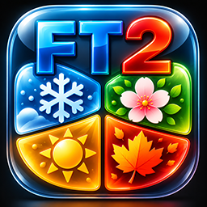

<p align="center">
  
</p>
<h1 align="center">JahreszeitenTracker</h1>

**[English version](README.en.md)**

Bei unbeabsichtigten inhaltlichen Abweichungen zwischen diesen README-Fassungen ist die deutsche Fassung maßgeblich. Der offizielle GPL-Lizenztext in `LICENSE` bleibt davon unberührt.

Kostenloses Open-Source-Hobbyprojekt für **Farm Together 2** auf macOS. Der JahreszeitenTracker zeigt die aktuelle Jahreszeit und die verbleibende Zeit bis zum nächsten Saisonwechsel an.

## Funktionen

- Automatische Erkennung mehrerer FT2-Hauptfarmen und ihrer vorhandenen Bereiche.
- Übersicht und Farmdetails mit Saisonbildern und Countdown; eigene Kartenreihenfolge und ausblendbare Farmen.
- Einmalige Saison-Erinnerungen als lokale macOS-Benachrichtigungen. Bereits geplante Erinnerungen können auch nach dem Beenden der App erscheinen, sofern Benachrichtigungen erlaubt sind.
- Automatisches Einlesen neuer Spielstände; gültige letzte Referenzen werden bei vorübergehend fehlendem Ordnerzugriff weiterverwendet.
- Deutsch und Englisch über die normalen macOS-Spracheinstellungen, ohne eigenen Sprachschalter.

## Voraussetzungen und Verwendung

**macOS 14 Sonoma oder neuer**, Apple Silicon oder Intel. Release-Builds unterstützen beide Architekturen (`arm64` und `x86_64`). Farm Together 2 wird separat benötigt und nicht mitgeliefert.

In den Einstellungen den FT2-Spielstandordner ausdrücklich auswählen. Der Tracker erkennt die Hauptfarmen darin automatisch. **FT2-Spielstände werden ausschließlich gelesen und niemals verändert.**

Derzeit bestätigte FT2-Spielstandversionen: **347, 350 und 352**. Die Zwischenversionen 348, 349 und 351 sind nicht bestätigt. Neuere unbekannte Versionen werden erkannt und defensiv geprüft. Nicht sicher lesbare Daten ersetzen keine gültige Referenz; unbestätigte Metadaten sind keine autoritative Grundlage für die Entfernung bekannter Farmen. Eine Versionsnummer allein ist keine Kompatibilitätsfreigabe.

## Installation und erster Start

1. Die DMG öffnen und `JahreszeitenTracker.app` auf `Programme` ziehen.
2. Die App aus dem Programme-Ordner starten.
3. Falls macOS/Gatekeeper den ersten Start blockiert, die App bewusst unter **Systemeinstellungen → Datenschutz & Sicherheit → Dennoch öffnen** freigeben. Diesen Schritt nur vornehmen, wenn die Herkunft der App vertrauenswürdig ist. [Weitere Informationen von Apple](https://support.apple.com/de-de/102445).
4. Beim ersten erfolgreichen Start in den Einstellungen **Spielstandordner auswählen …** wählen und den Ordner der eigenen Steam-ID auswählen.

Üblicher Speicherort:

```text
~/Library/Application Support/Milkstone Studios/FarmTogether2/SteamStorage/<Steam-ID>/
```

`<Steam-ID>` steht für deine eigene Steam-ID. Wähle diesen Steam-ID-Ordner aus, nicht den übergeordneten Ordner `SteamStorage`. JahreszeitenTracker erkennt anschließend die vorhandenen Hauptfarmen und Grundstücke automatisch und greift **ausschließlich lesend** auf die FT2-Spielstände zu; diese werden niemals verändert.

Die veröffentlichte App ist **ad-hoc signiert**, aber weder mit einer Apple Developer ID signiert noch von Apple notarisiert. macOS/Gatekeeper kann deshalb nach dem Download den ersten Start blockieren.

Für die derzeitige kostenlose Hobbyprojekt-Verteilung wird bewusst kein kostenpflichtiger Apple-Developer-Account verwendet. Dieser Signierungszustand ist eine bewusste Eigenschaft der Verteilung; eine spätere Developer-ID-Signierung oder Notarisierung wird damit nicht zugesagt.

## Selbst bauen und prüfen

Benötigt werden macOS und Xcode mit einem zum Projekt passenden Swift-Compiler sowie den Apple-Systemframeworks. Es gibt keine zusätzlichen Swift Packages oder eingebetteten FT2-/Steam-Bibliotheken.

```sh
xcodebuild -project JahreszeitenTracker.xcodeproj -scheme JahreszeitenTracker -configuration Debug -destination 'platform=macOS' build
sh Tests/run-tests.sh
sh Tests/run-localization-tests.sh /pfad/zum/gebauten/JahreszeitenTracker.app
```

Für eigene veränderte Builds oder Forks bitte zuerst die in [BRANDING.md](BRANDING.md) aufgeführten Grafiken durch eigene ersetzen, sofern keine gesonderte Erlaubnis vorliegt. Die Saisonbilder dürfen unter der GPL weiterverwendet werden.

Der optionale [WSS-DMG-Workflow](Distribution/README.md) benötigt zusätzlich Python 3.10 oder neuer mit `venv`/`pip` und lädt die externen MIT-lizenzierten Werkzeuge [ds-store 1.3.3](https://pypi.org/project/ds-store/1.3.3/) und [mac-alias 2.2.3](https://pypi.org/project/mac-alias/2.2.3/). Diese sind Buildabhängigkeiten, kein eigener Projektcode und werden nicht in die App eingebettet. Ihre Copyright- und Lizenzhinweise sind bei einer Weiterverteilung ihres Codes beizubehalten. Apple-Systemframeworks und Xcode unterliegen ihren eigenen Bedingungen.

## Lizenz und Herkunft

Copyright © 2026 WirdSchonSoftware.

Die eigenen Projektbestandteile sind unter der **GNU General Public License, ausschließlich Version 3 (SPDX: GPL-3.0-only)** lizenziert. Das umfasst insbesondere den Swift-Produktionscode, Tests und Testgeneratoren, Lokalisierungen, eigene Dokumentation, Build-/Distribution-Skripte und Konfigurationen sowie die Saisonbilder in `SeasonSpring.imageset`, `SeasonSummer.imageset`, `SeasonAutumn.imageset` und `SeasonWinter.imageset`.

Der vollständige, unveränderte offizielle GPLv3-Lizenztext steht in [LICENSE](LICENSE). Die Lizenzwahl dieses Projekts ist **GPL-3.0-only**; das allgemeine Anwendungsbeispiel am Ende des offiziellen Lizenzdokuments erweitert diese Wahl nicht auf spätere GPL-Versionen. Das Projekt wird ohne Gewährleistung im Rahmen der GPL bereitgestellt.

**WSS-Logo und JahreszeitenTracker-AppIcon sind separat behandelt und nicht unter GPL freigegeben.** Die exakten Dateien und die Erlaubnis zur unveränderten Weitergabe offizieller Veröffentlichungen stehen in [BRANDING.md](BRANDING.md). Diese Abgrenzung schränkt die GPL-Rechte am Quellcode und an den Saisonbildern nicht ein. Derzeitige und frühere Fremdwerkzeuge werden dadurch nicht unter eine eigene Projektlizenz gestellt.

Die Saisonbilder, das AppIcon und das WSS-Material wurden für dieses Projekt selbst beziehungsweise mit KI-Unterstützung erstellt und teilweise manuell bearbeitet. Die kleinen Save-Testprojektionen verwenden technische Einzelwerte aus eigenen FT2-Spielständen; vollständige Original-Spielstände, FT2-/Steam-DLLs oder dekompilierter Spielcode werden nicht mitgeliefert.

## Unabhängigkeit und Kontakt

Dieses Projekt steht in keiner Verbindung zu Milkstone Studios und wird von Milkstone Studios weder entwickelt noch unterstützt. Die Nennung von Farm Together 2 beschreibt lediglich die unterstützte Anwendung und vermittelt keine offiziellen Rechte oder Unterstützung.

- E-Mail: [kontakt@wirdschonsoftware.com](mailto:kontakt@wirdschonsoftware.com)
- Webseite: [wirdschonsoftware.com](https://wirdschonsoftware.com)
